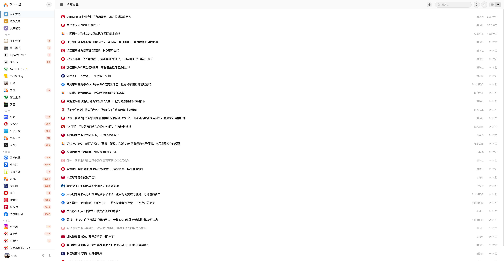
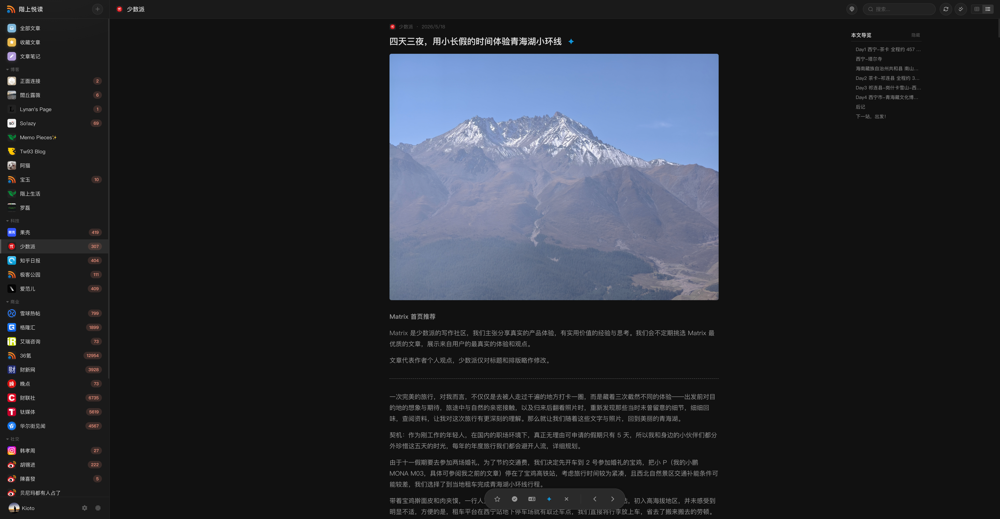
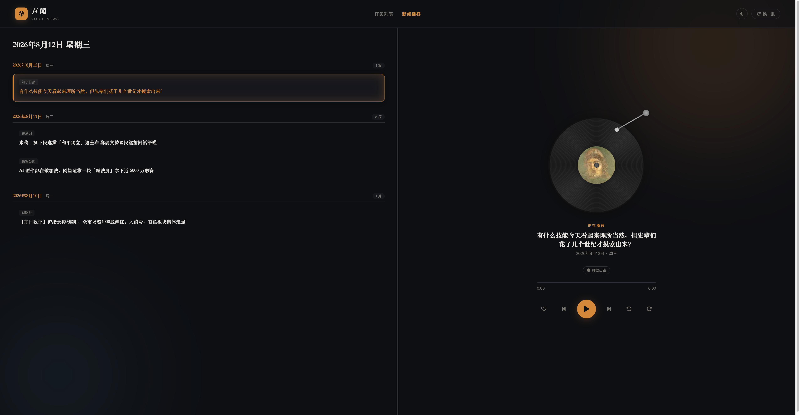

# Upstairs Reader

<p align="center">
  <strong>A self-hosted, multi-user RSS reader with AI summarization, TTS narration, and a newspaper-style reading experience.</strong>
</p>

<p align="center">
  
  
  
</p>

<p align="center">
  <a href="README.md">简体中文</a> | <strong>English</strong>
</p>

---

## Features

- **Multi-user support** — Registration, login, per-user read status, stars, and notes
- **RSS/Atom parsing** — Add any RSS or Atom feed URL; automatic periodic refresh
- **Feed organization** — Group feeds into custom categories (Tech, News, Blogs, etc.)
- **AI article summarization** — One-click summaries via OpenAI-compatible APIs (OpenAI, Aliyun Bailian, local LLMs)
- **TTS audio narration** — Automatically generates audio for starred articles (MiMo TTS or compatible)
- **Newspaper view** — A random curated newspaper-style reading mode with cover images
- **Personal profile pages** — Public pages showing starred articles and notes per user
- **Dark / Light themes** — Glass-morphism UI with system theme detection
- **Traditional / Simplified Chinese** — Built-in zh-Hant ↔ zh-Hans toggle
- **Docker support** — One-command deployment with `docker run` (multi-arch: amd64 / arm64)
- **Fever API compatible** — Works with RSS clients that support the Fever API protocol

## Screenshots

<div align="center">

**Main view (Light theme)**



**Article detail + AI summary (Dark theme)**



**Newspaper view + TTS narration (Audio View)**



</div>

## Tech Stack

| Layer | Technology |
|-------|-----------|
| Backend | Flask (Python) |
| Database | SQLite |
| RSS parsing | feedparser |
| AI / TTS | OpenAI-compatible API |
| Frontend | Vanilla JS + CSS (no bundler) |
| Deployment | Docker + Docker Compose |

## Quick Start

### Local Development

```bash
git clone https://github.com/ztshia/upstairs-reader.git
cd upstairs-reader
pip install -r requirements.txt
python app.py
```

Then open **http://localhost:5321**

> The first registered user automatically becomes the administrator.

### Docker (Recommended)

Use the Docker Hub image (multi-arch: amd64 / arm64):

```bash
docker run -d --name upstairs-reader -p 5321:5321 \
  -v $(pwd)/data:/data \
  -e DB_PATH=/data/rss.db \
  ztshia/upstairs-reader:latest
```

The app will be available at **http://localhost:5321**.

> - The database file `rss.db` lives in `$(pwd)/data` on the host (set by the volume mount + `DB_PATH`; both must match)
> - The database is initialized automatically on first start; mount `./audio_cache:/app/audio_cache` to persist TTS audio
> - On Linux servers, fix permission issues with: `mkdir -p data && chown -R 1000:1000 data`
> - The first registered user automatically becomes the administrator

Or use the bundled docker-compose:

```bash
docker compose up -d
```

## Configuration

### Environment Variables

| Variable | Default | Description |
|----------|---------|-------------|
| `DB_PATH` | `data/rss.db` (inside the project data dir) | SQLite database file path |

### Admin Settings

Once logged in as the administrator (first registered user), you can configure:

- **Registration** — Toggle open registration on/off
- **AI Summarization** — Configure API endpoint, key, model, and minimum article length
- **TTS** — Configure TTS API for article audio generation

### AI Summarization

Upstairs Reader supports any OpenAI-compatible API. Tested providers:

- OpenAI / Azure OpenAI
- Aliyun Bailian (阿里云百炼)
- Ollama / local LLMs
- Any service with a `/chat/completions` endpoint

In Settings → System Admin, set the API URL, key, and model name.

### TTS (Text-to-Speech)

Currently supports MiMo TTS and compatible APIs. Configure in Settings → System Admin. Audio files are cached in `audio_cache/`.

## API Reference

### Feeds

| Method | Path | Description |
|--------|------|-------------|
| `GET` | `/api/feeds` | List all feeds with item counts |
| `POST` | `/api/feeds` | Add a feed (`{url}`, optional `group_id`) |
| `PUT` | `/api/feeds/<id>` | Update feed title or group |
| `DELETE` | `/api/feeds/<id>` | Delete a feed and its items |
| `POST` | `/api/feeds/<id>/refresh` | Refresh a single feed |
| `PUT` | `/api/feeds/<id>/read-all` | Mark all items in feed as read |

### Items

| Method | Path | Description |
|--------|------|-------------|
| `GET` | `/api/items` | List items (`feed_id`, `group_id`, `q`, `unread`, `limit`, `offset`) |
| `GET` | `/api/items/<id>` | Get a single item |
| `PUT` | `/api/items/<id>/read` | Mark read/unread (`{is_read}`) |
| `PUT` | `/api/items/<id>/star` | Toggle star (`{is_starred}`) — triggers AI+TTS on star |
| `PUT` | `/api/items/<id>/note` | Set a note (`{note}`) |
| `GET` | `/api/items/starred` | List starred items |
| `GET` | `/api/items/notes` | List items with notes |

### Groups

| Method | Path | Description |
|--------|------|-------------|
| `GET` | `/api/groups` | List groups |
| `POST` | `/api/groups` | Create group (`{name}`) |
| `PUT` | `/api/groups/<id>` | Rename group |
| `DELETE` | `/api/groups/<id>` | Delete group |
| `PUT` | `/api/groups/<id>/feeds` | Assign feeds to group |

### Auth

| Method | Path | Description |
|--------|------|-------------|
| `POST` | `/api/auth/register` | Register (`{username, password}`) |
| `POST` | `/api/auth/login` | Login (`{username, password}`) → returns `api_key` |

### AI & Stats

| Method | Path | Description |
|--------|------|-------------|
| `POST` | `/api/ai/summarize/<id>` | Generate AI summary for an article |
| `GET` | `/api/stats` | Feed/item/unread/starred counts |
| `GET` | `/api/settings/ai` | Get AI settings (admin) |
| `PUT` | `/api/settings/ai` | Update AI settings (admin) |
| `GET` | `/api/settings/registration` | Check registration status |
| `PUT` | `/api/settings/registration` | Toggle registration (admin) |

### Fever API (RSS Client Integration)

| Method | Path | Description |
|--------|------|-------------|
| `GET`/`POST` | `/api/fever` | Fever-compatible endpoint for RSS clients |

### User Profiles

| Method | Path | Description |
|--------|------|-------------|
| `GET` | `/api/user/<username>/profile` | Public profile with starred items & notes |
| `PUT` | `/api/user/profile` | Update display name & avatar |

## Database Schema

```sql
feeds(id, url, title, description, icon_url, site_url, custom_title, group_id, added_at, updated_at)
items(id, feed_id, guid, title, link, author, content, summary, published, is_read, is_starred, note, fetched_at, created_on_time)
users(id, username, password_md5, api_key, display_name, avatar, default_view, created_at)
groups(id, name, sort_order, created_at)
user_items(user_id, item_id, is_read, is_starred, note)
article_summaries(item_id, summary, created_at, audio_status, audio_path)
site_settings(key, value)
```

## Project Structure

```
upstairs-reader/
├── app.py                 # Main Flask application
├── requirements.txt       # Python dependencies
├── Dockerfile            # Docker build
├── docker-compose.yml    # Docker Compose config
├── static/
│   ├── index.css         # Stylesheet (dark/light themes)
│   ├── favicon.ico       # Favicon
│   ├── logo.png          # App logo
│   └── avatars/          # User avatar uploads
├── templates/
│   ├── index.html        # Main reader UI
│   ├── login.html        # Login page
│   ├── newspaper.html    # Newspaper reading mode
│   └── people.html       # Public profile page
├── data/                 # Persistent data (Docker volume)
└── audio_cache/          # TTS audio cache
```

## Deployment

### Docker (VPS / Home Server / NAS)

Use the Docker Hub image (multi-arch: amd64 / arm64):

```bash
docker run -d --name upstairs-reader -p 5321:5321 \
  -v $(pwd)/data:/data \
  -e DB_PATH=/data/rss.db \
  ztshia/upstairs-reader:latest
```

- Data lives in `$(pwd)/data/rss.db` on the host (the volume mount and `DB_PATH` must match)
- On Linux servers, fix permission errors with: `mkdir -p data && chown -R 1000:1000 data`
- Use nginx / Caddy as a reverse proxy, point your domain to `localhost:5321`, then set up HTTPS with Let's Encrypt

Or use the bundled compose:

```bash
git clone https://github.com/ztshia/upstairs-reader.git
cd upstairs-reader
docker compose up -d
```

### On Synology NAS

Option 1 (Docker): if your NAS supports Docker, pull the image as described above.

Option 2 (Python directly):

```bash
# Install Python 3, then:
pip install -r requirements.txt -i https://mirrors.aliyun.com/pypi/simple/ --trusted-host mirrors.aliyun.com
python app.py
```

## Contributing

Contributions are welcome! Feel free to open issues or pull requests.

1. Fork the repository
2. Create a feature branch
3. Make your changes
4. Submit a pull request

## License

MIT License — see [LICENSE](LICENSE) file for details.

---

<p align="center">
  Built with ❤️ for people who love reading.
</p>
