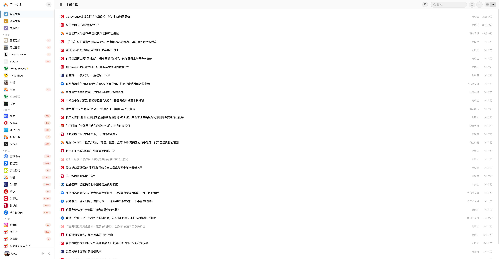
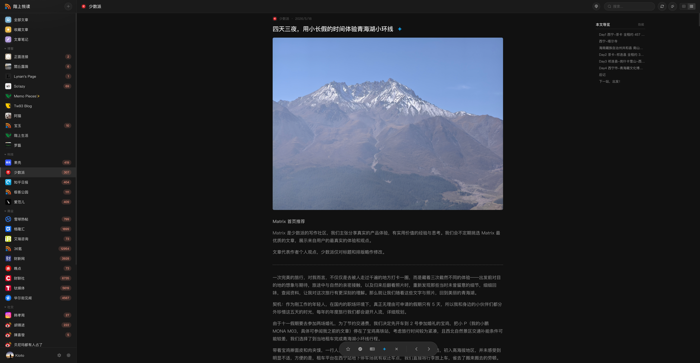
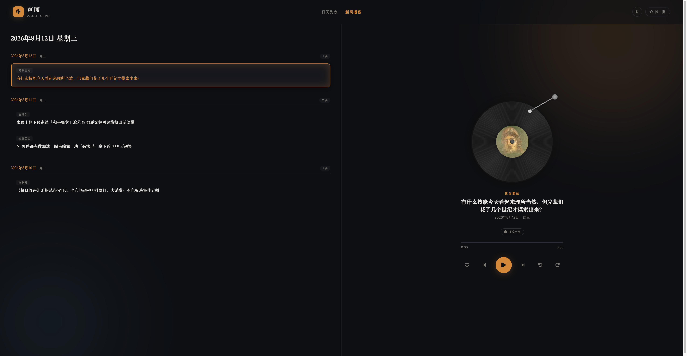

# Upstairs Reader

<p align="center">
  <strong>一个可自托管的多用户 RSS 阅读器，支持 AI 文章摘要、TTS 语音朗读和报纸式阅读体验。</strong>
</p>

<p align="center">
  
  
  
</p>

<p align="center">
  <a href="README.en.md">English</a> | <strong>简体中文</strong>
</p>

---

## 特性

- **多用户支持** — 注册、登录，每位用户独立的已读/收藏/笔记状态
- **RSS/Atom 解析** — 添加任意 RSS 或 Atom 订阅源，自动定时刷新
- **订阅分组** — 将订阅源归入自定义分类（科技、新闻、博客等）
- **AI 文章摘要** — 一键调用兼容 OpenAI 的 API 生成文章摘要（支持 OpenAI、阿里云百炼、本地大模型）
- **TTS 语音朗读** — 收藏文章时自动合成语音（支持 MiMo TTS 及兼容接口）
- **报纸视图** — 随机精选的报纸式阅读模式，带封面图片
- **个人主页** — 每位用户的公开页面，展示收藏和笔记
- **深色 / 浅色主题** — 玻璃质感 UI，跟随系统主题自动切换
- **繁简中文切换** — 内置简体中文 ↔ 繁體中文一键切换
- **Docker 部署** — `docker run` 一键启动（amd64 / arm64 多架构）
- **Fever API 兼容** — 支持 Fever 协议的 RSS 客户端

## 截图 Screenshots

<div align="center">

**主界面（浅色主题）**



**文章详情 + AI 摘要（深色主题）**



**报纸视图 + 语音朗读（声闻页面）**



</div>

## 技术栈

| 层级 | 技术 |
|------|------|
| 后端 | Flask（Python） |
| 数据库 | SQLite |
| RSS 解析 | feedparser |
| AI / TTS | OpenAI 兼容 API |
| 前端 | 原生 JS + CSS（无需打包工具） |
| 部署 | Docker + Docker Compose |

## 快速开始

### 本地开发

```bash
git clone https://github.com/ztshia/upstairs-reader.git
cd upstairs-reader
pip install -r requirements.txt
python app.py
```

打开 **http://localhost:5321**

> 第一个注册的用户自动成为管理员。

### Docker（推荐）

使用 Docker Hub 镜像（支持 amd64 / arm64 多架构）：

```bash
docker run -d --name upstairs-reader -p 5321:5321 \
  -v $(pwd)/data:/data \
  -e DB_PATH=/data/rss.db \
  ztshia/upstairs-reader:latest
```

应用将在 **http://localhost:5321** 可用。

> - 数据库文件为 `rss.db`，保存在宿主机 `$(pwd)/data` 目录（由 volume 挂载 + `DB_PATH` 决定，两者需配套）
> - 首次启动自动初始化数据库；`TTS 音频缓存` 挂载 `./audio_cache:/app/audio_cache` 可持久化朗读音频
> - Linux 服务器上如遇写权限错误：`mkdir -p data && chown -R 1000:1000 data`
> - 第一个注册的用户自动成为管理员

或者使用项目自带的 docker-compose：

```bash
docker compose up -d
```

## 配置说明

### 环境变量

| 变量 | 默认值 | 说明 |
|------|--------|------|
| `DB_PATH` | `data/rss.db`（项目 data 目录） | SQLite 数据库文件路径 |

### 管理员设置

以管理员身份登录（第一个注册的用户）后，可配置：

- **开放注册** — 开关新用户注册功能
- **AI 摘要** — 配置 API 地址、密钥、模型和最小文章字数
- **TTS** — 配置语音合成 API

### AI 摘要配置

支持任意兼容 OpenAI 的 API。已验证的提供商：

- OpenAI / Azure OpenAI
- 阿里云百炼
- Ollama / 本地大模型
- 任何提供 `/chat/completions` 端点的服务

在 设置 → 系统管理 中填写 API 地址、密钥和模型名称。

### TTS 语音合成

目前支持 MiMo TTS 及兼容接口。在 设置 → 系统管理 中配置。音频文件缓存于 `audio_cache/`。

## API 参考

### 订阅源

| 方法 | 路径 | 说明 |
|------|------|------|
| `GET` | `/api/feeds` | 列出所有订阅源及文章数量 |
| `POST` | `/api/feeds` | 添加订阅源（`{url}`，可选 `group_id`） |
| `PUT` | `/api/feeds/<id>` | 更新订阅源标题或分组 |
| `DELETE` | `/api/feeds/<id>` | 删除订阅源及其文章 |
| `POST` | `/api/feeds/<id>/refresh` | 刷新单个订阅源 |
| `PUT` | `/api/feeds/<id>/read-all` | 标记该订阅源全部已读 |

### 文章

| 方法 | 路径 | 说明 |
|------|------|------|
| `GET` | `/api/items` | 文章列表（支持 `feed_id`、`group_id`、`q`、`unread`、`limit`、`offset`） |
| `GET` | `/api/items/<id>` | 获取单篇文章详情 |
| `PUT` | `/api/items/<id>/read` | 标记已读/未读（`{is_read}`） |
| `PUT` | `/api/items/<id>/star` | 收藏/取消收藏（`{is_starred}`）— 收藏时自动触发 AI 摘要和 TTS |
| `PUT` | `/api/items/<id>/note` | 设置笔记（`{note}`） |
| `GET` | `/api/items/starred` | 获取收藏列表 |
| `GET` | `/api/items/notes` | 获取有笔记的文章列表 |

### 分组

| 方法 | 路径 | 说明 |
|------|------|------|
| `GET` | `/api/groups` | 列出所有分组 |
| `POST` | `/api/groups` | 创建分组（`{name}`） |
| `PUT` | `/api/groups/<id>` | 重命名分组 |
| `DELETE` | `/api/groups/<id>` | 删除分组 |
| `PUT` | `/api/groups/<id>/feeds` | 批量设置订阅源归属 |

### 认证

| 方法 | 路径 | 说明 |
|------|------|------|
| `POST` | `/api/auth/register` | 注册（`{username, password}`） |
| `POST` | `/api/auth/login` | 登录（`{username, password}`）→ 返回 `api_key` |

### AI 与统计

| 方法 | 路径 | 说明 |
|------|------|------|
| `POST` | `/api/ai/summarize/<id>` | 生成文章 AI 摘要 |
| `GET` | `/api/stats` | 订阅/文章/未读/收藏数量统计 |
| `GET` | `/api/settings/ai` | 获取 AI 设置（管理员） |
| `PUT` | `/api/settings/ai` | 更新 AI 设置（管理员） |
| `GET` | `/api/settings/registration` | 查看注册开放状态 |
| `PUT` | `/api/settings/registration` | 开关注册（管理员） |

### Fever API（RSS 客户端集成）

| 方法 | 路径 | 说明 |
|------|------|------|
| `GET`/`POST` | `/api/fever` | Fever 兼容端点，供 RSS 客户端对接 |

### 用户资料

| 方法 | 路径 | 说明 |
|------|------|------|
| `GET` | `/api/user/<username>/profile` | 公开资料（收藏 + 笔记） |
| `PUT` | `/api/user/profile` | 更新显示名和头像 |

## 数据库结构

```sql
feeds(id, url, title, description, icon_url, site_url, custom_title, group_id, added_at, updated_at)
items(id, feed_id, guid, title, link, author, content, summary, published, is_read, is_starred, note, fetched_at, created_on_time)
users(id, username, password_md5, api_key, display_name, avatar, default_view, created_at)
groups(id, name, sort_order, created_at)
user_items(user_id, item_id, is_read, is_starred, note)
article_summaries(item_id, summary, created_at, audio_status, audio_path)
site_settings(key, value)
```

## 项目结构

```
upstairs-reader/
├── app.py                 # 主 Flask 应用
├── requirements.txt       # Python 依赖
├── Dockerfile            # Docker 构建文件
├── docker-compose.yml    # Docker Compose 配置
├── static/
│   ├── index.css         # 样式表（深色/浅色主题）
│   ├── favicon.ico       # 网站图标
│   ├── logo.png          # 应用 Logo
│   └── avatars/          # 用户头像上传目录
├── templates/
│   ├── index.html        # 主阅读器界面
│   ├── login.html        # 登录页面
│   ├── newspaper.html    # 报纸阅读模式
│   └── people.html       # 个人主页
├── data/                 # 持久化数据（Docker 卷挂载）
└── audio_cache/          # TTS 音频缓存
```

## 部署方案

### Docker（VPS / 家庭服务器 / NAS）

使用 Docker Hub 镜像（amd64 / arm64 多架构）：

```bash
docker run -d --name upstairs-reader -p 5321:5321 \
  -v $(pwd)/data:/data \
  -e DB_PATH=/data/rss.db \
  ztshia/upstairs-reader:latest
```

- 数据保存在宿主机 `$(pwd)/data/rss.db`（volume 挂载与 `DB_PATH` 需配套）
- Linux 服务器如遇写权限错误：`mkdir -p data && chown -R 1000:1000 data`
- 使用 nginx / Caddy 做反向代理，将域名指向 `localhost:5321`，再通过 Let's Encrypt 配置 HTTPS

或使用项目自带的 compose：

```bash
git clone https://github.com/ztshia/upstairs-reader.git
cd upstairs-reader
docker compose up -d
```

### 群晖 NAS 部署

方式一（Docker）：NAS 支持 Docker 时，与上方 Docker 方式相同，拉取镜像即可。

方式二（Python 直跑）：

```bash
# 安装 Python 3，然后执行：
pip install -r requirements.txt -i https://mirrors.aliyun.com/pypi/simple/ --trusted-host mirrors.aliyun.com
python app.py
```

## 参与贡献

欢迎提交 Issue 和 Pull Request！

1. Fork 本仓库
2. 创建功能分支
3. 提交你的修改
4. 发起 Pull Request

## 许可证

MIT License — 详见 [LICENSE](LICENSE) 文件。

---

<p align="center">
  为热爱阅读的人而建 ❤️
</p>
